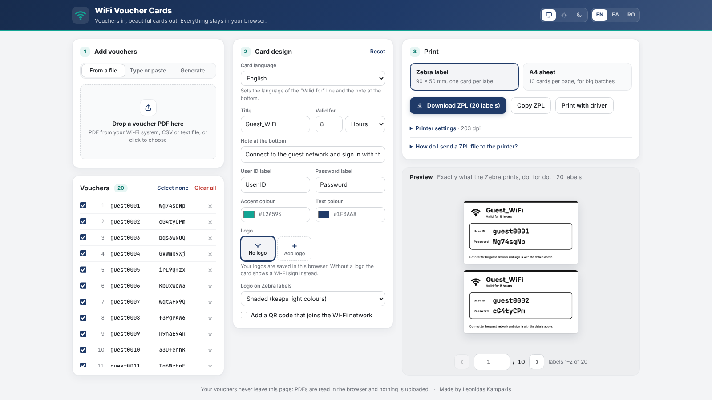

# WiFi Voucher Cards

Turn guest Wi-Fi vouchers into good-looking cards, ready to hand out.

**Open it: https://voucher.kampaxis.com**

<picture>
  <source media="(prefers-color-scheme: dark)" srcset="docs/screenshot-dark.png">
  
</picture>

- **Add vouchers** from the PDF your firewall prints (FortiGate tested), a CSV or text file, by typing or pasting them, or by generating random codes.
- **Print on a Zebra label printer** (ZD421, 203 dpi, 90 × 50 mm labels) with a ready-made ZPL file, or through the normal printer driver.
- **Print on A4** for big batches: 10 cards per page with cut lines, or save as PDF.
- **Everything stays in your browser.** PDFs are read on your computer and nothing is uploaded anywhere.

The app is available in **English, Greek and Romanian**. It picks the browser's language, and you can switch with EN / ΕΛ / RO at the top. The card language is set separately under *Card design*.

Light and dark mode: pick one, or let it follow the system, with the buttons at the top. On a computer the whole app fits in the window without scrolling, from a laptop up to a 4K screen, and browser zoom still works.

## Using it

The page has three columns, one for each step.

1. **Add vouchers.** Pick how at the top of the box:
   - *From a file*: drop the voucher PDF (or a CSV/text file) on the page, or click to choose it.
   - *Type or paste*: add one voucher at a time, or paste a whole list.
   - *Generate*: make a batch of random codes, with options like a password generator (length, easy to say / easy to read / all characters, uppercase, lowercase, numbers and symbols, numbered or random usernames). The codes come from the browser's secure random numbers. Guests can only sign in once the same usernames and passwords are added to your Wi-Fi system (for example as FortiGate guest users).

   The vouchers list below always stays in view. Untick vouchers to leave them out of a print run, or remove them with ×. *Clear all* asks for confirmation inside the page.
2. **Card design.** Set the card language, title (default *Guest_WiFi*), how long the vouchers last (a number with minutes / hours / days, 8 hours by default, or hide the line), the note at the bottom, labels, colours and logo. A FortiGate PDF fills in the duration for you when it says how long the vouchers last.
   - The Hellenic Cables and Corinth Pipeworks logos are built in, and each one brings its own card colours. You can add your own logos too: they are saved in your browser so you can switch between them, and you can delete them. With *No logo* the card shows a Wi-Fi sign next to the title.
   - You can add a QR code that joins the Wi-Fi network.
3. **Print.** Pick the output:
   - **Zebra label**: *Download ZPL* and send it to the printer (see below), *Copy ZPL*, or *Print with driver*.
   - **A4 sheet**: *Print A4 / save as PDF*. Print at 100% (Actual size) with background graphics on.

The preview shows exactly what will print, one A4 page or a couple of labels at a time. Turn the pages with the arrows, by typing a page number, with the mouse wheel, or with the arrow keys.

Your card design and logos are remembered in this browser. The voucher list is cleared when you close the tab.

## Sending the ZPL file to a ZD421

The ZPL file holds one label per voucher, each drawn as a 1-bit image at the printer's own resolution, so the label looks exactly like the preview.

- **Zebra Setup Utilities** (Windows): select the printer → *Open Communication With Printer* → *Send File*.
- **Shared printer on Windows**: `copy /b vouchers.zpl \\localhost\ZD421` (use the printer's share name).
- **Network printer**: `nc <printer-ip> 9100 < vouchers.zpl`.

Under *Printer settings* you can switch to 300 dpi, print more than one copy of each card, set darkness or speed, and shift the print if it isn't centred on the label.

If you print with the driver instead, set the paper size to 90 × 50 mm, scale 100%, and no margins.

## Input formats

| Source | Example |
| --- | --- |
| FortiGate voucher PDF | `User ID user0161` / `Password bexchzgf` / `Expiration 12 hour(s) and 0 minute(s)` |
| Labeled text | `Username: alice Password: s3cret` |
| CSV / one per line | `alice,s3cret` · `alice;s3cret` · `alice<TAB>s3cret` · `alice s3cret` |
| Code-only vouchers | `Voucher code: ABCD-1234`, or one code per line |

Scanned PDFs (pictures of text) can't be read; type those vouchers in instead.

## Hosting on your own domain

The site is plain static files on GitHub Pages (this copy runs at voucher.kampaxis.com). To use a subdomain of your own, such as `wifi.example.com`:

1. At your DNS provider, add a `CNAME` record for `wifi` that points to `leothegreat777.github.io`.
2. In the repo, open **Settings → Pages**, enter the domain under *Custom domain* and save. Once the DNS check passes, tick **Enforce HTTPS**.
3. Optional but recommended: verify the domain under your GitHub account's **Settings → Pages**, so nobody else can claim it.

If a FortiGate web filter blocks a new domain, submit it to FortiGuard for rating (https://www.fortiguard.com/webfilter, category *Information Technology*), or add a Web Rating Override on your own FortiGate for an immediate fix.

## Development

No build step. Serve the folder with any static web server and open it:

```sh
python3 -m http.server 8000   # then open http://localhost:8000
npm test                      # parser, generator, translation and ZPL tests (Node 20+)
```

| File | What it does |
| --- | --- |
| `js/parse.js` | Finds vouchers in text |
| `js/generate.js` | Random voucher codes |
| `js/qr.js` | The Wi-Fi QR code |
| `js/pdf-import.js` | Reads text from PDFs with pdf.js |
| `js/card.js` | The card layout (SVG, in millimetres) and the A4 sheet |
| `js/raster.js` | Draws a card as 1-bit dots for the Zebra |
| `js/zpl.js` | Builds compressed ZPL (`^GFA` graphic fields) |
| `js/i18n.js` | English, Greek and Romanian text |
| `js/settings.js` | Saved design, printer settings and logos |
| `js/main.js` | The page |

## Credits

Made by Leonidas Kampaxis.

- [pdf.js](https://github.com/mozilla/pdf.js) (Apache-2.0), in `vendor/pdfjs`
- [qrcode-generator](https://github.com/kazuhikoarase/qrcode-generator) by Kazuhiko Arase (MIT), in `vendor/qrcode.mjs`
- [Inter](https://rsms.me/inter/) and [JetBrains Mono](https://www.jetbrains.com/lp/mono/) fonts (SIL Open Font License), in `vendor/fonts`
- The Hellenic Cables and Corinth Pipeworks logos in `assets/` belong to those companies and are not covered by the MIT licence.
